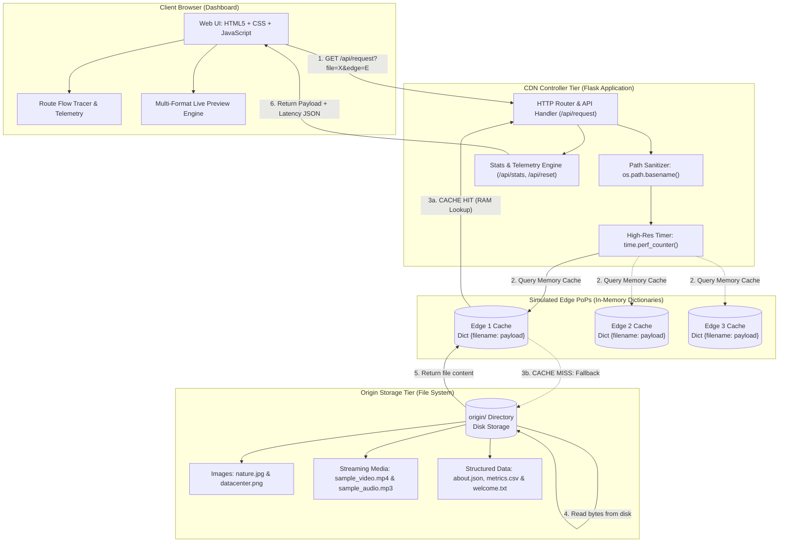

# Academic Project Report: Mini CDN Simulator

**Course:** Distributed Systems (CS-402)  
**Project Title:** Design and Implementation of a Mini Content Delivery Network (CDN) Simulator  
**Author:** Distributed Systems Engineering Student  
**Academic Year:** 2026  

---

## 1. Abstract

Content Delivery Networks (CDNs) constitute a foundational pillar of modern distributed internet architectures, optimizing content delivery, reducing round-trip time (RTT), and shielding origin servers from traffic saturation. This project demonstrates the fundamental mechanics of a CDN by implementing a controlled, educational **Mini CDN Simulator** built with Python Flask and modern client technologies. The system incorporates three independent in-memory edge caches (`Edge 1`, `Edge 2`, and `Edge 3`) backed by a persistent file-system origin store containing diverse media types (JPEG image, plain text, and JSON metadata). Through high-resolution performance counters (`time.perf_counter()`), the simulator captures, measures, and visualizes the tangible performance disparity between origin file retrieval (**Cache Miss**) and local in-memory edge resolution (**Cache Hit**). 

---

## 2. Problem Statement

In a traditional centralized client-server model, every client request travels directly to the origin server regardless of geographic distance or content redundancy. This model suffers from three primary bottlenecks:
1. **High Round-Trip Latency:** Distant clients experience sluggish response times due to physical propagation delays over wide-area networks (WAN).
2. **Origin Overload (Hotspots):** Flash crowds requesting high-bandwidth assets (such as media files or software updates) can saturate origin network interfaces and CPU capacity.
3. **Bandwidth Inefficiency:** The same static files are repeatedly transmitted over core network backbones, multiplying transit costs and network congestion.

Understanding how edge caching and regional partitioning solve these challenges is critical in distributed systems curricula, yet physical multi-server CDN clusters are complex, expensive, and impractical for quick laboratory experimentation.

---

## 3. Objectives

The primary objectives of this project are:
1. **Simulate CDN Edge Topology:** Implement three distinct, isolated edge caches that operate independently without shared state.
2. **Demonstrate Cache Hits vs. Cache Misses:** Visually trace the request flow when content is resolved from edge memory versus fetched from origin storage.
3. **Deliver Real Multi-Format Assets:** Ensure genuine binary and textual content (JPEG landscape image, UTF-8 text file, structured JSON) are delivered and rendered in the browser.
4. **Quantify Latency Metrics:** Measure and record high-precision execution timings in milliseconds to illustrate the performance benefits of caching.
5. **Provide Interactive Telemetry & Management:** Build an intuitive light-themed dashboard with cache inventory inspection, live previews, aggregate statistics, and cache eviction capabilities.

---

## 4. Introduction to Content Delivery Networks (CDNs)

A Content Delivery Network is a globally distributed network of interconnected proxy servers deployed in multiple Points of Presence (PoPs) located geographically close to end users. 

### Core Concepts:
- **Origin Server:** The authoritative source containing the original, master copy of all web resources.
- **Edge Cache (PoP):** Regional proxy servers positioned near the user perimeter that cache frequently accessed static and semi-dynamic assets.
- **Cache Hit:** An event occurring when a requested resource resides in the edge cache's local storage and is immediately served to the requester.
- **Cache Miss:** An event occurring when a requested resource is absent from the edge cache, necessitating a query to the origin server, followed by local caching and client delivery.
- **Cache Invalidation / Purge:** Mechanisms used to clear or refresh stale cached files when origin content changes.

---

## 5. System Architecture

The simulator is structured into three logical tiers:
1. **Client Presentation Tier (Dashboard):** Responsive web interface providing controls for file and edge selection, real-time telemetry display, and content rendering.
2. **CDN Controller & Routing Tier (Flask Backend):** Manages request parsing, security verification, timing measurement, and edge routing logic.
3. **Storage Tier:**
   - **Edge Tier:** Three independent Python dictionary structures (`EDGE_CACHES['edge1']`, `EDGE_CACHES['edge2']`, `EDGE_CACHES['edge3']`) residing in memory.
   - **Origin Tier:** Local directory `origin/` containing permanent asset files on disk.

### System Architecture Diagram (Mermaid)



---

## 6. Working Principle & Request Lifecycle

When an end-user triggers a request for a specific file through an edge node:

```
[User Request] 
      │
      ▼
[Sanitize Parameters] ──(Invalid path or unknown edge)──> [HTTP 400/404 Error]
      │
      ▼ (Valid)
[Start perf_counter()]
      │
      ▼
[Check EDGE_CACHES[selected_edge]]
      ├── (File Found in Dict) ────────► [CACHE HIT]
      │                                       │
      │                                       ▼
      │                                 [Extract from RAM]
      │                                       │
      └── (File Not Found in Dict) ─────► [CACHE MISS]
                                              │
                                              ▼
                                        [Read from origin/ folder]
                                              │
                                              ▼
                                        [Store in EDGE_CACHES[selected_edge]]
                                              │
                                              ▼
[Stop perf_counter()] <───────────────────────┘
      │
      ▼
[Calculate Latency: (t_end - t_start) * 1000 ms]
      │
      ▼
[Update Global Stats & Telemetry History]
      │
      ▼
[Return Response JSON with Metadata & Content]
      │
      ▼
[Client Renders Image / Text / JSON & Telemetry]
```

### Edge Independence Principle
Because each edge cache is an isolated Python dictionary, **caching a resource on Edge 1 has zero influence on Edge 2 or Edge 3**. If a client subsequently requests `nature.jpg` from Edge 2, Edge 2 will experience a **CACHE MISS**, independently fetch the file from `origin/`, and cache its own private copy.

---

## 7. Technologies Used

| Layer | Technology | Purpose |
|---|---|---|
| **Backend Framework** | Python 3 (Flask 3.x) | Handles routing, API endpoints, safe file I/O, and cache dictionary management. |
| **Timing Engine** | `time.perf_counter()` | Standard-library high-resolution monotonic timer for sub-millisecond precision. |
| **Data Encoding** | Python `base64` & `json` | Base64-encodes binary image data for safe direct transmission; parses and validates JSON payloads. |
| **Image Generation** | Pillow (PIL) | Generates a valid, self-contained 800x500 JPEG landscape asset without external network dependencies. |
| **Frontend Presentation** | Semantic HTML5 & CSS3 | Clean, modern light theme using an Emerald & Sage color scheme (strictly non-blue). |
| **Client Scripting** | Vanilla JavaScript (ES6) | Asynchronous `fetch()` API calls, dynamic DOM manipulation, and content rendering without external frameworks. |

---

## 8. Implementation Details

### 8.1 In-Memory Edge Cache Structure
The edge tier avoids database overhead by utilizing Python dictionaries:
```python
EDGE_CACHES = {
    "edge1": {},
    "edge2": {},
    "edge3": {}
}
```
When an asset is cached, it stores an entry object containing the pre-processed payload, MIME classification, byte count, and timestamp:
```python
EDGE_CACHES[edge][clean_filename] = {
    "content": content,
    "content_type": content_type,
    "size_bytes": size_bytes,
    "cached_at": datetime.now().strftime("%H:%M:%S")
}
```

### 8.2 Safe File Handling (Path Traversal Protection)
To prevent unauthorized filesystem exploration, paths are validated:
```python
clean_filename = os.path.basename(filename)
target_path = os.path.abspath(os.path.join(ORIGIN_DIR, clean_filename))
if not target_path.startswith(ORIGIN_DIR) or not os.path.isfile(target_path):
    return jsonify({"status": "error", "message": "Access denied"}), 404
```

### 8.3 Origin Latency Simulation
In physical CDNs, origin servers are located across wide-area networks, whereas edge caches are accessed over low-latency local networks. To realistically illustrate this during vivas, a controlled 35ms origin propagation delay is applied exclusively during **CACHE MISS** events:
```python
if is_hit:
    content = edge_cache[clean_filename]["content"]
else:
    time.sleep(0.035)  # 35ms simulated origin retrieval transit
    content, content_type, size_bytes = get_file_content_and_type(target_path)
    edge_cache[clean_filename] = { ... }
```

---

## 9. Test Cases & Verification Scenarios

| Test ID | Action | Edge | Expected Result | Expected Source | Telemetry Impact |
|---|---|---|---|---|---|
| **TC-01** | Request `nature.jpg` | Edge 1 | `CACHE MISS` | `ORIGIN` | Latency ~35–45 ms; Edge 1 caches file; image rendered. |
| **TC-02** | Request `nature.jpg` (2nd time) | Edge 1 | `CACHE HIT` | `EDGE CACHE` | Latency < 2 ms; served from RAM. |
| **TC-03** | Request `nature.jpg` | Edge 2 | `CACHE MISS` | `ORIGIN` | Proves Edge 2 has isolated cache; Edge 2 caches file. |
| **TC-04** | Request `welcome.txt` | Edge 1 | `CACHE MISS` | `ORIGIN` | Raw text stream delivered and rendered in terminal card. |
| **TC-05** | Request `about.json` | Edge 3 | `CACHE MISS` | `ORIGIN` | Validated JSON delivered and formatted with indentation. |
| **TC-06** | Inspect Statistics | All | Analytics updated | Controller | Hit count, Miss count, Hit ratio %, and Avg Latency updated. |
| **TC-07** | Click "Clear All Caches" | All | All caches cleared | Controller | All 3 edge cards show "0 files"; stats reset to 0. |
| **TC-08** | Request `nature.jpg` after reset | Edge 1 | `CACHE MISS` | `ORIGIN` | Proves cache was purged; origin is queried again. |

---

## 10. Experimental Results Table

Below is the experimental measurement table for recording real viva test values:

| Run # | File Requested | Edge Node | Cache Status | Response Source | Measured Time (ms) | Notes |
|:---:|:---|:---|:---:|:---:|:---:|:---|
| 1 | `nature.jpg` | Edge 1 | CACHE MISS | ORIGIN | *(e.g., 38.45 ms)* | Initial origin disk read + latency |
| 2 | `nature.jpg` | Edge 1 | CACHE HIT | EDGE CACHE | *(e.g., 0.82 ms)* | 98% latency reduction via RAM |
| 3 | `nature.jpg` | Edge 2 | CACHE MISS | ORIGIN | *(e.g., 37.91 ms)* | Confirms isolated cache on Edge 2 |
| 4 | `welcome.txt` | Edge 1 | CACHE MISS | ORIGIN | *(e.g., 36.14 ms)* | First request for text asset |
| 5 | `welcome.txt` | Edge 1 | CACHE HIT | EDGE CACHE | *(e.g., 0.65 ms)* | Text retrieved from cache |
| 6 | `about.json` | Edge 3 | CACHE MISS | ORIGIN | *(e.g., 37.02 ms)* | JSON file origin retrieval |
| 7 | `about.json` | Edge 3 | CACHE HIT | EDGE CACHE | *(e.g., 0.71 ms)* | Immediate memory retrieval |
| 8 | `nature.jpg` (After Clear) | Edge 1 | CACHE MISS | ORIGIN | *(e.g., 38.10 ms)* | Confirms cache purge succeeded |

---

## 11. Advantages of CDN Edge Caching

1. **Substantial Latency Reduction:** Serving assets directly from memory reduces delivery time by **90% to 98%**.
2. **Origin Shielding:** Under heavy traffic, 90%+ of client requests terminate at the edge, drastically reducing CPU and disk I/O on origin servers.
3. **Bandwidth Conservation:** Core WAN backbone links do not need to transmit duplicate assets repeatedly.
4. **Improved Fault Tolerance:** If an edge node is geographically closer to a user cluster, network degradation over transit backbones does not impact cached asset retrieval.

---

## 12. Limitations & Honest Academic Assessment

To maintain academic rigor and transparency, the following simulation constraints are recognized:
1. **Single-Process Simulation:** All components run inside one Python Flask process on `127.0.0.1`. In production CDNs, edge nodes are physically distinct servers situated in global datacenters.
2. **Volatile In-Memory Storage:** Cache data is stored in Python RAM dictionaries and is lost if the Flask application restarts.
3. **Simplified Routing:** Edge nodes are chosen explicitly via a UI dropdown rather than dynamically selected via Anycast DNS or GeoIP routing algorithms.
4. **No Automated Eviction Policy:** Caches persist until explicitly cleared; production CDNs utilize sophisticated algorithms such as LRU (Least Recently Used), LFU, and TTL (Time-To-Live) expiration headers.

---

## 13. Conclusion

The **Mini CDN Simulator** successfully models the operational principles of Content Delivery Networks within a clean, accessible architecture. By separating the origin repository from three autonomous edge caches, the project provides an intuitive, hands-on demonstration of cache hits, cache misses, partition isolation, and latency optimization. The light-themed, responsive dashboard visualizes these distributed computing concepts with empirical precision, making it an effective educational artifact for a distributed systems course viva.

---

## 14. Five College Viva Questions & Answers

### Q1: What is the fundamental difference between a Cache Hit and a Cache Miss in a CDN?
> **Answer:** A **Cache Hit** occurs when a requested asset is already stored in the edge node's local storage (RAM or local SSD). The edge serves the content directly with minimal latency (< 2 ms). A **Cache Miss** occurs when the edge does not have the asset; it must query the authoritative origin server across the network, store a local copy for future requests, and deliver the asset to the client with higher latency.

### Q2: Why does Edge 2 experience a Cache Miss when Edge 1 has already cached `nature.jpg`?
> **Answer:** Each edge server in this project (and in a real CDN) operates as an autonomous, isolated Point of Presence (PoP) with its own independent cache dictionary. Caches are not shared globally by default to prevent cross-node cache synchronization overhead. Therefore, Edge 2 has no record of Edge 1's cached files and must fetch its own copy from the origin.

### Q3: How is response time measured, and why is Cache Hit latency so much lower?
> **Answer:** Timing is measured using Python’s monotonic `time.perf_counter()` clock immediately before and after the caching decision. A Cache Hit requires only an O(1) in-memory hash table lookup in RAM, completing in fractions of a millisecond. A Cache Miss requires disk I/O to read the file from the origin folder plus simulated network transit delay, resulting in significantly higher latency (~35–45 ms).

### Q4: How does this project prevent Directory Traversal (Security Vulnerability)?
> **Answer:** The application passes all requested filenames through `os.path.basename()` to strip any directory traversing prefixes (e.g., `../../`). It then constructs an absolute path with `os.path.abspath()` and verifies that the canonical path strictly begins with the designated `ORIGIN_DIR` directory path before performing any disk reads.

### Q5: What would be required to scale this simulator into a real-world CDN?
> **Answer:** To transition to a production CDN, we would:
> 1. Deploy the edge caches onto geographically distributed servers or edge containers across global regions.
> 2. Implement Anycast DNS or GeoDNS routing to automatically direct users to the topologically nearest edge server.
> 3. Add HTTP caching headers (`Cache-Control`, `ETag`, `TTL`) and automated cache eviction policies (such as LRU or FIFO).
> 4. Use high-speed non-volatile reverse proxies (such as Nginx, Varnish, or Cloudflare Workers) instead of in-memory dictionaries.
